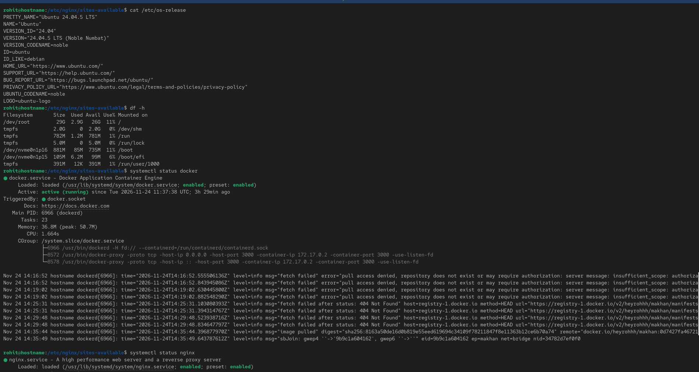
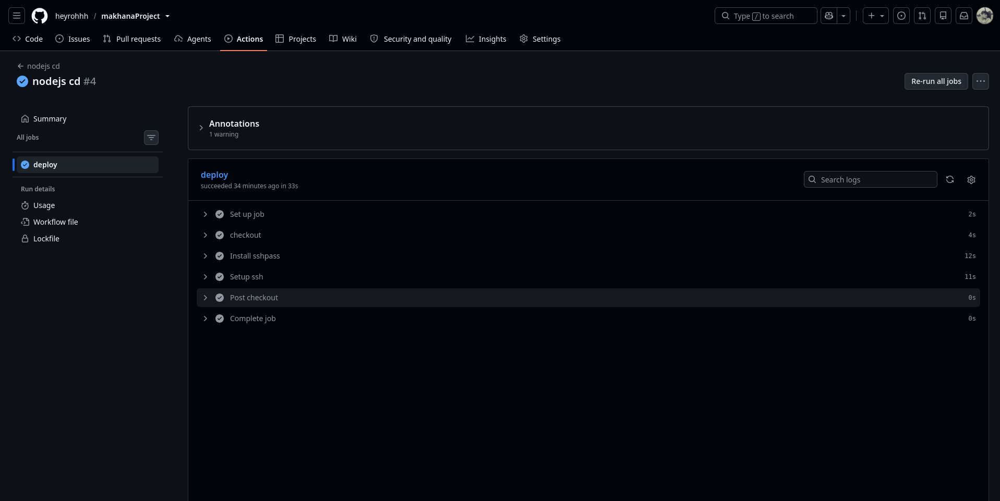
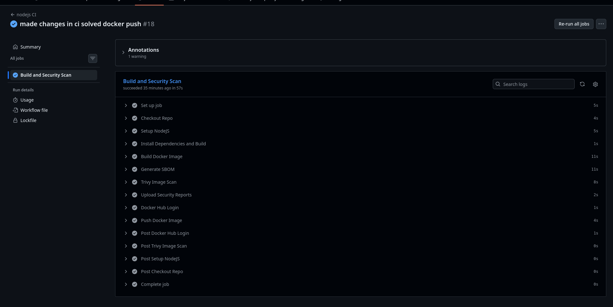
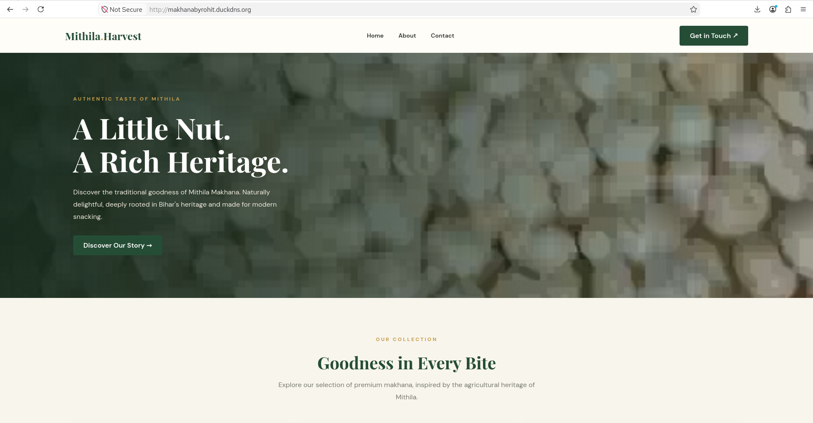

# Automated Website Deployment on Azure

## Project Overview
Automated infrastructure provisioning and website
deployment on Azure VM using Terraform, Ansible,
Docker and GitHub Actions.

## Architecture
Developer → GitHub → GitHub Actions → Docker Hub
                              ↓
                         Azure VM
                              ↓
                         Ansible
                              ↓
                       Docker Container

## Tech Stack
- Azure
- Terraform
- Ansible
- Docker
- GitHub Actions
- Linux / Ubuntu

## Infrastructure Provisioning
Explain how Terraform provisions Azure resources.

## Configuration Management
Explain how Ansible configures the VM and installs
required dependencies.

## CI/CD Pipeline
1. Developer pushes code to GitHub.
2. Sbom Genrated
3. Trivy scanned docker image
4. GitHub Actions builds Docker image.
5. Image gets pushed to Docker Hub.
6. CD workflow connects to Azure VM.
7. Docker image gets pulled.
8. Application container gets deployed.

## Screenshots

